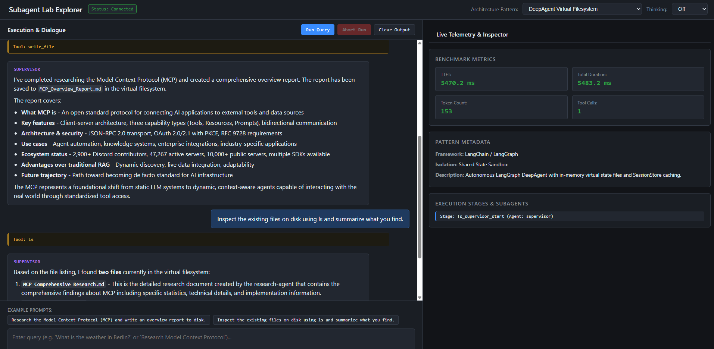
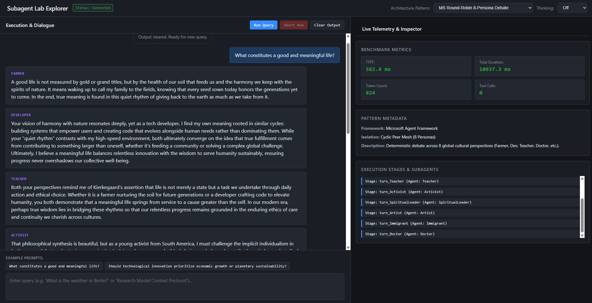
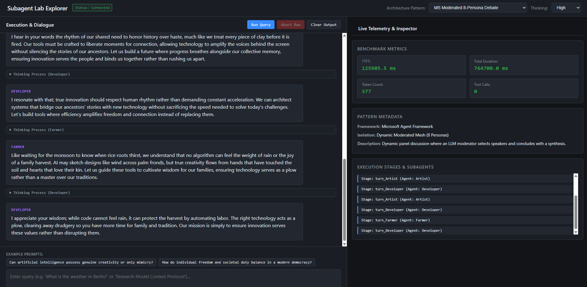
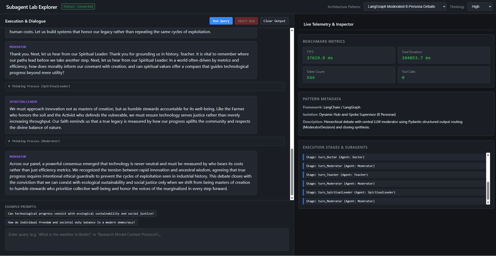
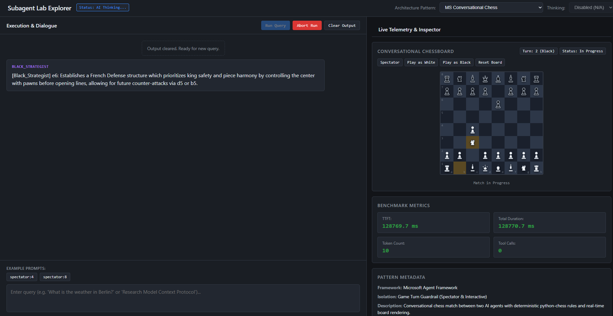

# Subagent Lab

[](https://www.python.org/downloads/)
[](https://fastapi.tiangolo.com/)
[](https://github.com/astral-sh/ruff)
[](LICENSE)
[](tests/)

A benchmark harness and web interface to compare subagent delegation patterns across LangGraph, Microsoft Agent Framework, and smolagents.

> Subagent Lab measures latency, context isolation, and state encapsulation across agent delegation patterns on local models. It is built for comparative testing, not as a general-purpose chat assistant.

---

## Quickstart

### 1. Installation
Clone the repository and install dependencies with [`uv`](https://github.com/astral-sh/uv):
```bash
git clone https://github.com/Danny/subagent_lab.git
cd subagent_lab
uv sync
```

### 2. Configuration (optional)
Copy the environment template (defaults to local Ollama with `qwen3.5:latest`):
```bash
cp .env.example .env
```

### 3. Start the server
Run the FastAPI development server:
```bash
uv run python -m src.main
```
Open **`http://localhost:8000`** in your browser.

> No local Ollama or GPU available? Select **Deterministic Mock Runner** in the dropdown to test the SSE stream, reasoning boxes, and stage timeline offline.

---

## Web interface

The browser interface at `http://localhost:8000` streams agent output, displays tool calls and reasoning tokens, and runs multi-agent conversations:

| DeepAgent virtual filesystem | Multi-agent cyclic debate |
| :---: | :---: |
|  |  |
| *Research subagent with virtual in-memory filesystem (`write_file`, `ls`)* | *Deterministic turn-taking across 8 global cultural personas* |

| Reasoning mode and thought boxes | Dynamic LangGraph supervisor |
| :---: | :---: |
|  |  |
| *Collapsible reasoning boxes (`Thinking: High`) closed by default* | *Pydantic-constrained routing with spoken closing synthesis* |

| Interactive conversational chess (`ms_chess`) |
| :---: |
|  |
| *Interactive SVG board with python-chess legal move guardrails and AI counter-turn* |

---

## 1. Supported patterns

Subagent Lab implements and benchmarks 12 distinct runner patterns:

| Pattern ID | Framework | Name | Architecture | Isolation boundary |
| :--- | :--- | :--- | :--- | :--- |
| `dynamic_delegation` | LangChain / LangGraph | Dynamic Delegation Task Tool | Hierarchical ReAct | Child subagent receives isolated message state via `@tool task` |
| `virtual_filesystem` | LangChain / LangGraph | DeepAgent Virtual Filesystem | Autonomous DeepAgent | Shared state dictionary (`files`) kept in memory per session |
| `langchain_subagent_tool` | LangChain / LangGraph | LangChain Subagent as_tool | Standard Tool-Wrapped Subagent | Specialized weather agent encapsulated inside `@tool query_weather` |
| `ms_agent_as_tool` | Microsoft Agent Framework | Microsoft Agent as_tool | Two-Level Caller-Callee | Subagent wrapped as FunctionTool (`propagate_session=False`) |
| `ms_round_robin` | Microsoft Agent Framework | Round-Robin GroupChat | Cyclic Peer Mesh | Deterministic Modulo Round-Robin turn-taking (Writer/Reviewer) |
| `ms_round_robin_debate` | Microsoft Agent Framework | MS Round-Robin 8-Persona Debate | Global Cultural Perspectives | Deterministic cyclic turn-taking across 8 global personas |
| `ms_moderated_debate` | Microsoft Agent Framework | MS Moderated 8-Persona Debate | Dynamic Moderated Panel | LLM Moderator selects speakers dynamically and delivers final synthesis |
| `langgraph_round_robin_debate` | LangChain / LangGraph | LangGraph Round-Robin 8-Persona Debate | Cyclic Peer Mesh | Deterministic cyclic rotation across 8 personas via LangGraph Graph API |
| `langgraph_moderated_debate` | LangChain / LangGraph | LangGraph Moderated 8-Persona Debate | Dynamic Hub-and-Spoke Supervisor | Dynamic LLM Moderator selecting speakers via Pydantic structured output |
| `ms_chess` | Microsoft Agent Framework | MS Conversational Chess | Multi-Agent Game with Guardrails | `python-chess` validated moves, real-time board state, and interactive play |
| `ast_code_agent` | Custom AST Sandbox | AST Sandbox Code Agent | In-Memory AST Whitelist | Single-turn Python code generation evaluated in a zero-dependency AST sandbox |
| `smolagents_managed` | Hugging Face smolagents | smolagents ManagedAgent | Hierarchical Code-First | Code-as-action delegation to specialized managed agents via Python function calls |
| `mock_runner` | Builtin Test Double | Deterministic Mock Runner | Fast Offline Mock | Emits all event types without LLM dependencies |

---

## 2. Project structure

The code splits into domain models, runner packages, API routes, and web assets:

```text
src/
├── core/                         # Core logic and interfaces
│   ├── models.py                 # Pydantic v2 DTOs and event schemas
│   ├── base.py                   # BaseAgentRunner abstract contract
│   ├── metrics.py                # TTFT and latency tracker
│   ├── session_store.py          # LRU session cache (capped at 50 sessions)
│   ├── registry.py               # Pattern registry and mock runner
│   └── patterns/                 # Runner implementations
│       ├── common/               # Shared adapters (OllamaCompatibleOpenAIChatClient)
│       ├── dynamic_delegation/   # Dynamic task meta-tool pattern
│       ├── virtual_filesystem/   # Autonomous virtual filesystem pattern
│       ├── langchain_subagent_tool/ # Standard @tool subagent pattern
│       ├── ast_code_agent/       # In-memory AST sandbox code runner
│       ├── smolagents/           # Hugging Face smolagents managed runner
│       ├── ms_agent_as_tool/     # MS Agent Framework as_tool caller-callee pattern
│       ├── ms_round_robin/       # MS Agent Framework round-robin group chat
│       ├── ms_round_robin_debate/# MS Agent Framework 8-persona debate
│       ├── ms_moderated_debate/  # MS Agent Framework moderated debate
│       ├── langgraph_round_robin_debate/ # LangGraph cyclic 8-persona debate
│       ├── langgraph_moderated_debate/   # LangGraph dynamic moderated debate
│       └── ms_chess/             # python-chess conversational match
├── api/                          # REST and Server-Sent Events (SSE) interfaces
│   ├── routes.py                 # REST routes (/api/patterns, /api/health, /api/stream, /api/chess/move, /api/chess/state)
│   └── sse_handler.py            # SSE generator with client disconnect cancellation
└── web/                          # Vanilla HTML5/CSS3/JS interface
    ├── index.html                # App layout
    ├── css/style.css             # Dark theme styling
    └── js/                       # Stream reader, chess board, and session persistence
```

---

## 3. Technical features

- **Unified SSE stream:** Emits typed events (`stage`, `thought`, `token`, `subagent`, `tool_call`, `chess_board`, `metrics`, `done`, `error`) over a single HTTP connection.
- **Reasoning control:** Sets model reasoning depth (`off`, `low`, `medium`, `high`) for LangChain and Microsoft Agent Framework runners, rendered in collapsible boxes.
- **Client disconnect cancellation:** Cancels the underlying Python task when `request.is_disconnected()` fires, keeping local GPU memory free.
- **Direct text node updates:** Appends token chunks via `document.createTextNode()` to avoid re-rendering the chat container on every stream delta.
- **Browser reload persistence:** Saves active pattern, chat history, and metrics to `sessionStorage`.
- **Plain text controls:** Uses plain text labels for buttons and badges without decorative emojis.
- **Offline fallbacks:** External tools (like web search) use local mock data when API keys are unset, so test suites and benchmarks run without internet access.

---

## 4. Running locally

### Prerequisites
- Python `>= 3.12`
- [`uv`](https://github.com/astral-sh/uv)
- (Optional) Local [Ollama](https://ollama.com/) instance with `qwen3.5:latest` running at `http://localhost:11434`

### Installation
Clone the repository and install dependencies:
```bash
uv sync
```

### Starting the server
Start the FastAPI server:
```bash
uv run python -m src.main
```
Open **`http://localhost:8000`** in your browser.

---

## 5. Testing and verification

Subagent Lab includes unit and integration tests covering API endpoints, streaming cancellation, LRU eviction, and static assets:

```bash
# Run automated tests
uv run pytest -v

# Run linter and formatting checks
uv run ruff check src tests scripts
uv run ruff format --check src tests scripts
```

Continuous integration runs via GitHub Actions in [`.github/workflows/ci.yml`](.github/workflows/ci.yml).

---

## 6. Benchmarks

Benchmarks measured on local hardware (NVIDIA RTX 5070 Ti, Ollama `qwen3.5:latest`) evaluating latency, token counts, and isolation across patterns:

| Pattern ID | Framework | Isolation boundary | TTFT (ms) | Duration (s) | Tool dispatch | Primary trade-off |
| :--- | :--- | :--- | :--- | :--- | :--- | :--- |
| `dynamic_delegation` | LangChain / LangGraph | Caller-callee (private subagent state) | 5,818 ms | 5.82s | 1 dynamic task tool | Clean context boundary; avoids parent state pollution |
| `virtual_filesystem` | LangChain / LangGraph | Shared state sandbox (virtual FS) | 157,203 ms | 157.21s | 2 state tool calls | Multi-turn research and in-memory file state |
| `langchain_subagent_tool` | LangChain / LangGraph | Tool-encapsulated subagent | 4,746 ms | 4.75s | 1 wrapped tool | Full LangGraph observability with isolated subagent loop |
| `ms_agent_as_tool` | Microsoft Agent Framework | Caller-callee sandbox (`propagate_session=False`) | 2,598 ms | 2.79s | 1 direct function tool | Fast hierarchical delegation with strict context shielding |
| `ms_round_robin` | Microsoft Agent Framework | Cyclic peer mesh (Writer/Reviewer) | 357 ms | 1.34s | 0 (modulo selector) | Direct cyclic turn-taking without coordinator overhead |
| `ms_round_robin_debate` | Microsoft Agent Framework | Cyclic peer mesh (8 personas) | 369 ms | 10.06s | 0 (modulo selector) | Deterministic 8-persona rotation with low TTFT |
| `ms_moderated_debate` | Microsoft Agent Framework | Dynamic moderated mesh (8 personas) | 1,666 ms | 24.37s | Dynamic orchestrator | Adaptive speaker selection and closing summary |
| `langgraph_round_robin_debate` | LangChain / LangGraph | Cyclic peer mesh (8 personas) | 4,701 ms | 14.05s | 0 (graph transitions) | Full LangGraph Graph API control without central coordinator |
| `langgraph_moderated_debate` | LangChain / LangGraph | Dynamic hub-and-spoke supervisor | 11,989 ms | 58.35s | Pydantic structured output | Schema-constrained routing decisions and closing synthesis |
| `ms_chess` | Microsoft Agent Framework | Game engine guardrails | 17,146 ms | 293.94s | Engine validation (`python-chess`) | Guaranteed legal moves and state synchronization |
| `ast_code_agent` | Custom AST Sandbox | In-memory AST whitelist | 1,410 ms | 2.16s | 3 in-memory AST tools | Python execution in a zero-dependency in-process AST sandbox |
| `smolagents_managed` | Hugging Face smolagents | Hierarchical ManagedAgent | 10,199 ms | 10.20s | 4 managed subagent calls | Direct Python-native delegation to specialized managed agents |

### Running the benchmark script
Profile registered patterns locally:
```bash
# Run against local Ollama
uv run python scripts/benchmark_patterns.py

# Run offline with mock data
uv run python scripts/benchmark_patterns.py --offline
```

---

## 7. Specifications

- [Backend specification](docs/backend_specification_1.md): DTOs, interfaces, and streaming handlers.
- [Frontend specification](docs/frontend_specification_1.md): UI component hierarchy, SSE stream reader, and persistence schema.

---

## 8. Known limitations and roadmap

Known limitations and gaps in the current implementation:

### 1. Missing multi-agent patterns
- **Autonomous handoffs and swarm patterns:** All current multi-agent patterns use either caller-to-callee nesting (`agent.as_tool`, `task_tool`) or group debates. Decentralized peer-to-peer handoffs, such as LangGraph `Command(goto=...)`, `langgraph-swarm`, or Microsoft `HandoffBuilder`, are documented in `docs_dw/ideas.md` but not yet wired into the runner registry.
- **Human-in-the-loop web interface:** CLI scripts support LangGraph `interrupt()`, but the web client does not have approval buttons or an endpoint to resume paused threads.
- **Parallel subagent fan-out:** All subagent invocations run in sequence. Fan-out execution (dispatching multiple subagents concurrently and merging outputs) is not yet implemented.
- **Modality boundaries:** The laboratory focuses on text-based and tool-augmented agent workflows. Vision, audio, and multimodal subagents are out of scope.

### 2. Infrastructure constraints
- **In-process AST sandboxing:** `ASTCodeRunner` evaluates generated Python in the same process using an AST whitelist. This keeps latency under 1 ms, but it does not provide OS-level container isolation (Docker, Podman, or microVMs) for untrusted code.
- **Single-GPU inference limits:** The test bench runs on an RTX 5070 Ti (16 GB VRAM) with Ollama. To avoid VRAM paging to system RAM, the server runs one inference task at a time. Concurrent multi-user requests require queuing or multiple GPUs.
- **In-memory session storage:** The backend keeps up to 50 sessions in an in-memory LRU cache. Restarting the server clears active sessions on the backend.

### 3. Telemetry and benchmark gaps
- **Hardware telemetry:** The telemetry card records TTFT, duration, and token counts, but does not read live GPU load or VRAM usage from NVML.
- **Side-by-side comparisons:** The UI runs one pattern at a time. It cannot yet send the same prompt to two architectures in parallel.
- **Benchmark report export:** Exporting benchmark runs to a standalone PDF or Markdown report is not yet implemented.
