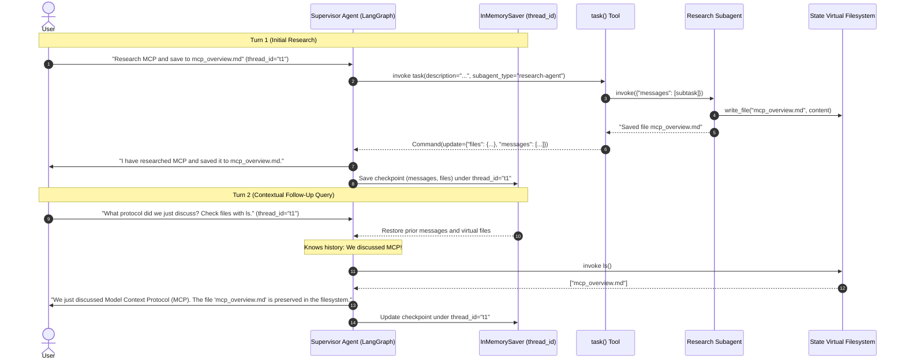

# DeepAgent with LangGraph checkpointer memory

This prototype extends `deep_agent_from_scratch` with LangGraph's `InMemorySaver` checkpointer to retain conversation history and virtual filesystem state across multiple turns.

---

## Architecture overview



---

## Key differences from deep_agent_from_scratch

| Feature | `deep_agent_from_scratch` | `deep_agent_from_scratch_memory` |
| :--- | :--- | :--- |
| **Checkpointer** | None (`create_agent` called without checkpointer) | `checkpointer=InMemorySaver()` configured |
| **Invocation config** | Bare invocation without thread configuration | Invocation with `config={"configurable": {"thread_id": ...}}` |
| **Conversational scope** | Single turn | Multi-turn memory with pronoun and reference resolution |
| **File persistence** | Lost on process exit | Preserved across turns in the same thread session |
| **System prompt** | Basic supervisor instructions | Preamble suppression and silent tool calling rules |

---

## Running the test

```bash
uv run python legacy_scripts/deep_agent_from_scratch_memory/app_test.py
```
