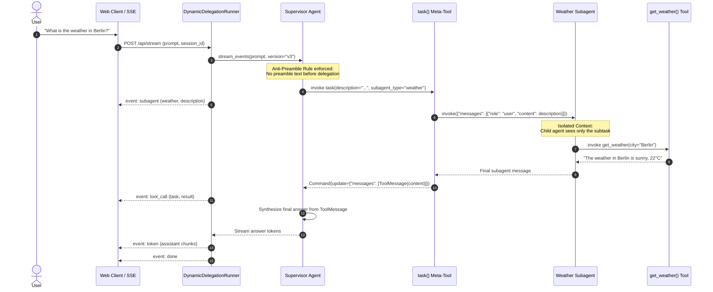

# Dynamic delegation pattern (task meta-tool)

This package implements dynamic delegation in LangGraph. A supervisor orchestrates specialized worker agents through an isolated `task()` meta-tool.

---

## 1. Architectural philosophy: hierarchy versus mesh

Coordination strategies in multi-agent systems divide into two models:

| Architectural property | Handoff or peer mesh | Dynamic delegation (caller-callee) |
| :--- | :--- | :--- |
| **Control transfer** | Permanent transfer (relay race) | Temporary delegation (subroutine or RPC call) |
| **Context scope** | Shared or accumulated conversation history | Strictly isolated session per subtask |
| **Return path** | Next agent continues conversation with user | Callee returns raw result to caller; caller synthesizes |
| **Memory footprint** | Grows with each agent turn | Minimal; child context is discarded after execution |
| **Local LLM reliability** | Prone to prompt pollution and role drift | High; small, targeted prompts per agent |

In dynamic delegation, subagents operate in a private sandbox. The child agent never receives the user's broader dialogue and does not communicate directly with the user. It receives a targeted subtask, solves it using its own specialized tools, and yields its final response back to the supervisor via a structured `ToolMessage`.

---

## 2. Sequence diagram



---

## 3. Module breakdown

The package separates state schemas, domain tools, agent definitions, delegation mechanics, and execution adapters:

- **[`state.py`](./state.py):**
  Defines `DynamicDelegationState`, a `TypedDict` containing an append-only message sequence using LangGraph's `add_messages` reducer.

- **[`tools.py`](./tools.py):**
  Defines leaf domain tools, such as `get_weather(city: str) -> str`, providing deterministic mock data without external network calls.

- **[`subagent.py`](./subagent.py):**
  Instantiates specialized child subagents using LangChain `create_agent`. Each subagent has its own system prompt, private state schema, and domain-specific toolset.

- **[`task_tool.py`](./task_tool.py):**
  The delegation factory (`create_task_tool`). Constructs a LangChain `@tool` whose docstring lists available subagent types. When invoked by the supervisor, it:
  1. Validates the requested `subagent_type`.
  2. Creates an isolated single-message state payload: `{"messages": [{"role": "user", "content": description}]}`.
  3. Executes the target subagent.
  4. Wraps the child's final response into a `ToolMessage` and returns a LangGraph `Command(update={"messages": [...]})`.

- **[`supervisor.py`](./supervisor.py):**
  Builds the coordinating supervisor graph equipped with the `task` meta-tool and anti-preamble prompt rules to prevent chat bubble inversion in user interfaces.

- **[`runner.py`](./runner.py):**
  The streaming execution adapter inheriting from `BaseAgentRunner`. Integrates LangGraph `stream_events(version="v3")` using `stream.interleave("messages", "tool_calls")` to stream reasoning tokens (`thought`), subagent dispatches (`subagent`), tool executions (`tool_call`), answer chunks (`token`), and performance metrics (`metrics`).

---

## 4. Engineering and runtime guardrails

### 4.1 Strict context isolation
The `task` tool constructs an independent input dictionary for the subagent:
```python
subagent_state = {"messages": [{"role": "user", "content": description}]}
result = sub_agent.invoke(subagent_state)
```
The child subagent never receives prior user messages, supervisor reflections, or sibling subagent outputs. This limits hallucinations and reduces token consumption on local models such as `qwen3.5:latest`.

### 4.2 Sequential tool execution for local LLMs
Local models often emit invalid concatenated JSON blocks when generating parallel function calls. Both the supervisor and child subagents enforce sequential tool invocation through their system prompts:
```text
Never call tools in parallel. Always invoke them sequentially.
```

### 4.3 Anti-preamble guardrail
When streaming events over Server-Sent Events (SSE) to interactive frontends, models emitting conversational preamble (such as *"I will check that for you..."*) before calling the `task` tool cause chat bubble fragmentation. The supervisor prompt forbids conversational preamble prior to delegation:
```text
Do not emit conversational preamble or preliminary remarks before delegating. Call the tool first.
```

### 4.4 LangGraph v3 streaming and channel draining
The runner consumes LangGraph v3 streams using interleaved channels. When a tool call event arrives (`kind == "tool_calls"`), the runner drains the `ToolCallStream` iterator completely:
```python
if hasattr(item, "__iter__"):
    for _ in item:
        pass
tool_output = getattr(item, "output", None)
```
This ensures the generator finishes and populates `item.output` before downstream processing.
