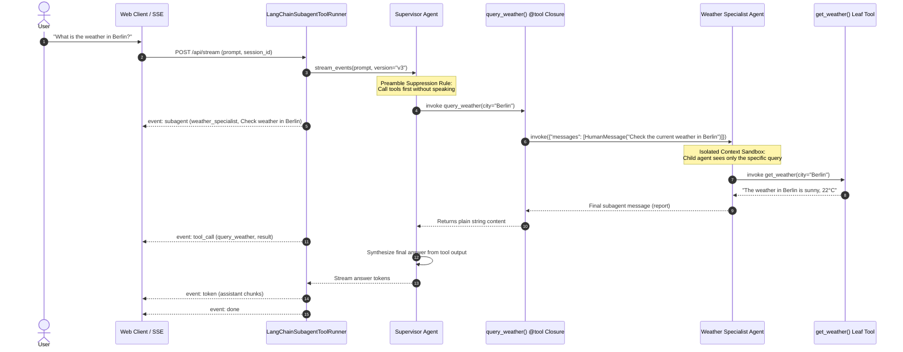

# LangChain subagent-as-tool pattern

This package implements the subagent-as-tool pattern in LangGraph. An entire compiled child agent runs directly inside the closure of a standard LangChain `@tool` function.

---

## 1. Architectural philosophy: direct tool closure, meta-tools, and peer mesh

Hierarchical delegation in multi-agent systems can be structured at different abstraction levels:

| Architectural property | Peer mesh (handoff) | Dynamic meta-tool (`task`) | Subagent-as-tool (`@tool` closure) |
| :--- | :--- | :--- | :--- |
| **Encapsulation style** | Control transfer (relays) | Generic routing meta-tool | Direct domain function `@tool` |
| **Supervisor interface** | `handoff_to_agent()` | `task(description, subagent_type)` | `query_weather(city: str)` |
| **Child return type** | Permanent dialogue handover | LangGraph `Command(update=...)` | Standard Python `str` |
| **Supervisor awareness** | Aware of peer network | Aware of generic delegation | Treats subagent as a standard Python tool |
| **Context isolation** | None (shared history) | High (isolated subtask payload) | Strict (isolated subtask payload) |
| **Complexity and overhead** | Medium to high | Medium (dynamic dispatch dictionary) | Minimal (pure function closure) |

In the subagent-as-tool pattern, the supervisor agent requires no custom delegation logic or meta-tool parser. To the supervisor, `query_weather` works like any other tool. When called, `query_weather` executes the compiled child agent in an isolated session, runs its internal logic and leaf tools, and returns a string summary back to the supervisor.

---

## 2. Sequence diagram



---

## 3. Module breakdown

The package separates leaf tools, agent definitions, and execution adapters:

- **[`tools.py`](./tools.py):**
  Defines leaf tools and the subagent encapsulation factory:
  - `get_weather(city: str) -> str`: Leaf tool providing deterministic weather data.
  - `create_subagent_tool(weather_subagent) -> BaseTool`: Dynamically creates a `@tool` named `query_weather(city: str)` that invokes the child subagent synchronously with an isolated single-turn message payload and returns `result["messages"][-1].content`.

- **[`subagent.py`](./subagent.py):**
  Instantiates the specialized child agent (`create_weather_specialist`) using LangChain `create_agent`. Equipped with its own system prompt and leaf tools (`get_weather`), it handles weather reporting.

- **[`supervisor.py`](./supervisor.py):**
  Constructs the supervisor agent (`create_supervisor_agent`). Bound with the `query_weather` tool and configured with anti-preamble prompt rules.

- **[`runner.py`](./runner.py):**
  The execution adapter inheriting from `BaseAgentRunner`. Binds the compiled graph to the SSE streaming API, consuming events via LangGraph `stream_events(version="v3")` and interleaving tokens (`token`), thoughts (`thought`), subagent delegations (`subagent`), and tool executions (`tool_call`).

---

## 4. Engineering and runtime guardrails

### 4.1 Function closure encapsulation (`create_subagent_tool`)
Rather than registering subagents into a global registry, the subagent is captured inside a standard Python function closure:
```python
def create_subagent_tool(weather_subagent: Any) -> BaseTool:
    @tool
    def query_weather(city: str) -> str:
        """Consult the specialized weather subagent to check weather conditions in any city."""
        result = weather_subagent.invoke(
            {"messages": [{"role": "user", "content": f"Check the current weather in {city}"}]}
        )
        return result["messages"][-1].content

    return query_weather
```
The resulting `query_weather` tool passes into any standard LangChain or LangGraph agent without additional framework wiring.

### 4.2 Strict caller-callee state isolation
The child subagent runs in a private session. It receives only a synthesized `HumanMessage` constructed from the tool arguments (`Check the current weather in {city}`). The child has no access to the supervisor's broader conversation history, preventing prompt pollution and reducing token usage on local models such as `qwen3.5:latest`.

### 4.3 Sequential tool execution
To eliminate JSON serialization and concatenation failures common to local models, both supervisor and subagent prompts enforce sequential single-tool calls:
```text
Always execute tools sequentially one at a time.
```

### 4.4 Anti-preamble guardrail
When streaming events over SSE to interactive frontends, conversational preambles (such as *"I will check the weather for you now..."*) before invoking tools cause chat bubble fragmentation in user interfaces. The supervisor prompt forbids conversational preamble:
```text
Do not emit conversational preamble or preliminary remarks before calling tools. Call the tool first.
```
This ensures tool and subagent events render before the final response text.

### 4.5 Real-time token streaming over SSE
LangGraph v3 `stream.interleave()` executes synchronously. The SSE streaming handler incorporates a cooperative `await asyncio.sleep(0)` yield after each queue insertion, ensuring token chunks stream to the client in real time without starving the event loop.
