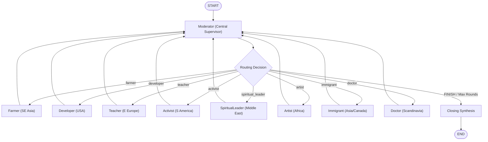

# LangGraph dynamic moderated 8-persona debate

## 1. Overview
This pattern implements a hub-and-spoke debate in LangGraph using `StateGraph`, `START`, `END`, Pydantic structured output, and `stream_events(..., version="v3")`.

A central `moderator` node evaluates the conversation history, dynamically selects the next perspective using Pydantic structured output (`ModeratorDecision`), frames the transition with a tailored question, and concludes the debate with a closing synthesis.

---

## 2. Graph topology and flow



---

## 3. Package structure

- **`state.py`**: Defines `ModeratedDebateState(MessagesState)` and the Pydantic structured output model `ModeratorDecision`.
- **`personas.py`**: Contains the 8 cultural perspectives, the `create_moderator_node` factory, `create_persona_node`, and ChatML template sanitization. Invokes structured output with `config={"callbacks": []}` to keep internal routing JSON out of the public stream.
- **`orchestration.py`**: Compiles the hub-and-spoke LangGraph `StateGraph` with dynamic conditional routing and spoke-to-hub return transitions.
- **`runner.py`**: Streaming adapter inheriting from `BaseAgentRunner`. Consumes `stream.messages` in version 3 format and yields `stage`, `thought`, `token`, `metrics`, and `done` events.

---

## 4. Structured output routing
The moderator node uses `model.with_structured_output(ModeratorDecision)` with `Literal[...]` constraints:
```python
class ModeratorDecision(BaseModel):
    thought: str = Field(description="Analysis of conversation flow so far")
    next_speaker: Literal[
        "farmer",
        "developer",
        "teacher",
        "activist",
        "spiritual_leader",
        "artist",
        "immigrant",
        "doctor",
        "FINISH",
    ]
    question_or_context: str = Field(description="Guidance framing the turn")
```

---

## 5. SSE event stream contract

| Event type | Payload schema | Description |
| :--- | :--- | :--- |
| `stage` | `StagePayload(stage="turn_<Speaker>", agent="<Speaker>")` | Emitted when turn transitions between moderator and personas. |
| `thought` | `ThoughtPayload(delta="...", source="<Speaker>")` | Streamed when thinking effort is enabled (`low`, `medium`, `high`). |
| `token` | `TokenPayload(delta="...", source="<Speaker>")` | Text delta emitted by the moderator or active persona. |
| `metrics` | `MetricsPayload(...)` | Telemetry including TTFT, duration, and token counts. |
| `done` | `DonePayload(final_answer="...")` | Final completion event with accumulated debate text. |
