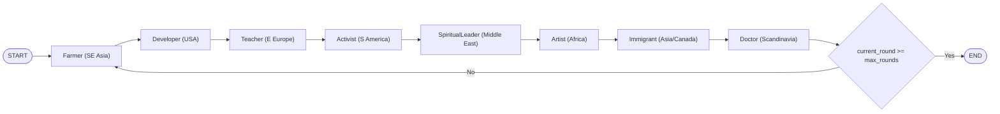

# LangGraph round-robin 8-persona debate

## 1. Overview
This pattern implements a cyclic debate across 8 cultural perspectives using LangGraph `StateGraph`, `START`, `END`, and `stream_events(..., version="v3")`.

Control transitions through an explicit ring of nodes. Turn progression is deterministic, eliminating moderator token overhead and reducing execution latency on local Ollama models.

---

## 2. Graph topology and flow

---

## 3. Package structure

- **`state.py`**: Declares `RoundRobinDebateState(MessagesState)` containing conversation history and round counters (`current_round: int`, `max_rounds: int`).
- **`personas.py`**: Defines the 8 cultural perspectives, role system prompts, and the ChatML template sanitization helper `_format_messages_for_ollama` preventing local model EOS stalls on consecutive assistant turns.
- **`orchestration.py`**: Compiles the cyclic LangGraph `StateGraph` with explicit entrypoint and conditional loop-back edges.
- **`runner.py`**: Streaming adapter inheriting from `BaseAgentRunner`. Consumes `stream.messages` in version 3 format and yields `stage`, `thought`, `token`, `metrics`, and `done` events.

---

## 4. ChatML role collision prevention
Local models running Qwen or Llama ChatML templates trigger immediate EOS tokens (`text=""`) when prompt history ends with a message having `role="assistant"`. In `personas.py`, `_format_messages_for_ollama` reformats prior peer responses into user-side dialog turns (`[Author]: Content`) before invoking `ChatOllama`.

---

## 5. SSE event stream contract

| Event type | Payload schema | Description |
| :--- | :--- | :--- |
| `stage` | `StagePayload(stage="turn_<Persona>", agent="<Persona>")` | Emitted when turn transitions to a new speaker. |
| `thought` | `ThoughtPayload(delta="...", source="<Persona>")` | Streamed when thinking effort is enabled (`low`, `medium`, `high`). |
| `token` | `TokenPayload(delta="...", source="<Persona>")` | Text delta emitted by the active speaker. |
| `metrics` | `MetricsPayload(...)` | Telemetry including TTFT, duration, and token counts. |
| `done` | `DonePayload(final_answer="...")` | Final completion event with accumulated debate text. |
