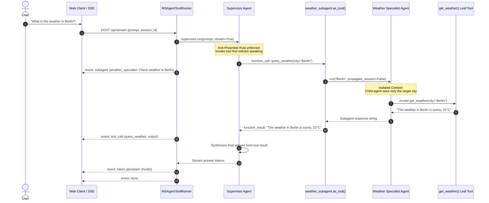

# Microsoft Agent Framework as_tool pattern

This package implements hierarchical caller-callee delegation using Microsoft Agent Framework (`agent-framework`). An independent child agent converts into an executable tool callable by a supervisor via `agent.as_tool(propagate_session=False)`.

---

## 1. Architectural philosophy: caller-callee encapsulation with as_tool()

Multi-agent coordination can use peer networks (handoff or mesh) or hierarchical parent-child structures:

| Architectural property | Peer handoff (`HandoffBuilder`) | Subagent-as-tool (`agent.as_tool()`) |
| :--- | :--- | :--- |
| **Delegation semantic** | Permanent transfer of conversational control | Subroutine call with automatic return to caller |
| **Context scope** | Transferred conversation history | Isolated execution (`propagate_session=False`) |
| **User interaction** | Callee communicates directly with user | Callee communicates only with caller; caller synthesizes |
| **Memory footprint** | Grows with every transition | Ephemeral; discarded once the tool returns |
| **Streaming loop** | Multiple agent turns on single stream | Single outer supervisor stream with nested tool execution |

By setting `propagate_session=False`, the child agent (`weather_specialist`) executes in a private session. It receives only the single extracted argument (`city`), executes its domain tools, and returns a string back to the supervisor without polluting the supervisor's broader conversation context.

---

## 2. Sequence diagram



---

## 3. Module breakdown

The package separates leaf tools, agent definitions, and execution adapters:

- **[`tools.py`](./tools.py):**
  Defines leaf tools, such as `get_weather(city: str) -> str`, providing deterministic weather responses without external network requests.

- **[`subagent.py`](./subagent.py):**
  Defines the child agent factory (`create_weather_specialist`). Configured with system instructions, domain tools (`get_weather`), and the shared `OllamaCompatibleOpenAIChatClient`.

- **[`supervisor.py`](./supervisor.py):**
  Constructs the coordinating supervisor agent (`create_supervisor_agent`). Converts the child agent into an executable tool via `weather_subagent.as_tool()`:
  ```python
  weather_tool = weather_subagent.as_tool(
      name="query_weather",
      description="Consult this specialist subagent to check weather conditions in any city.",
      arg_name="city",
      arg_description="The city to check the weather for.",
      propagate_session=False,
  )
  ```
  The supervisor's system instructions enforce tool invocation without conversational preamble.

- **[`runner.py`](./runner.py):**
  The execution adapter inheriting from `BaseAgentRunner`. Streams events via native asynchronous iteration (`async for update in supervisor.run(prompt, stream=True)`), parsing reasoning content (`text_reasoning`), tool invocations (`function_call`), tool outputs (`function_result`), answer tokens (`token`), and performance metrics (`metrics`).

---

## 4. Engineering and runtime guardrails

### 4.1 Caller-callee isolation with propagate_session=False
In Microsoft Agent Framework, `agent.as_tool()` can share or isolate context. By specifying `propagate_session=False`, the child agent runs in isolation:
- The child never receives prior user messages or supervisor reasoning.
- Token consumption remains minimal, which is essential for local models such as `qwen3.5:latest`.

### 4.2 Non-blocking asynchronous streaming
Unlike synchronous generator pipelines, Microsoft Agent Framework utilizes asynchronous iterators backed by `httpx.AsyncClient`:
```python
async for update in supervisor.run(prompt, stream=True):
```
Because socket reads use async `await` points, the runner yields control to the asyncio event loop on each incoming network chunk. FastAPI dispatches SSE tokens to the client without requiring sleep pauses or background threads.

### 4.3 Content type inspection for tool calls
In streaming mode, Microsoft Agent Framework emits structured items within `update.contents`:
- **`function_call`:** Extracted via `content.parse_arguments()` to dispatch an `event_type="subagent"` event to the UI timeline.
- **`function_result`:** Extracted from `content.result` to emit an `event_type="tool_call"` event with verified inputs and outputs.
- **`text_reasoning`:** Emitted as `event_type="thought"` events when thinking mode is active.

### 4.4 ChatML compatibility with OllamaCompatibleOpenAIChatClient
To prevent local Ollama models (such as Qwen 3.5 or Llama 3) from terminating on ChatML template conflicts, all agents connect through the client in `src/core/patterns/common/ms_client.py`.

### 4.5 Preamble suppression
Supervisor instructions enforce zero preamble before tool calls:
```text
When user asks for weather conditions in a city, you MUST call query_weather(city=...) immediately without preliminary remarks. Do not emit conversational preamble before calling tools.
```
This ensures tool invocation boxes render above the assistant's final response in the chat interface.
