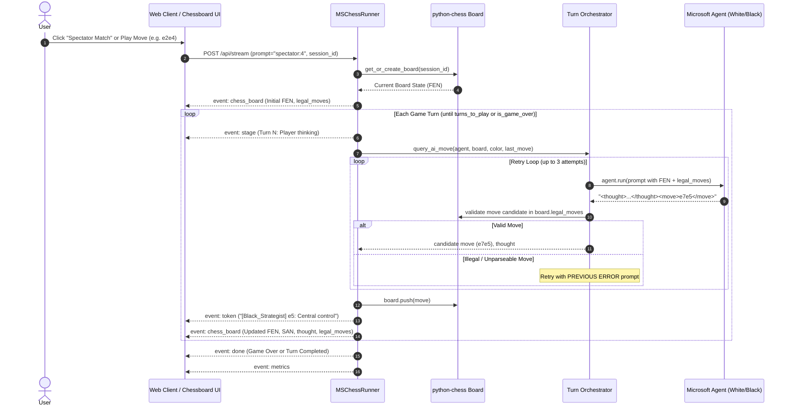

# Microsoft Agent Framework conversational chess pattern

This package implements conversational chess using Microsoft Agent Framework (`agent-framework`) and `python-chess`. It decouples persona-guided move generation (`White_Attacker`, `Black_Strategist`) from deterministic rule enforcement.

---

## 1. Architectural philosophy: deterministic engine guardrails versus LLM personas

Relying on a language model to maintain board state and enforce chess rules leads to hallucinations, illegal moves, and invalid terminations. This pattern uses `python-chess` as the single source of truth for the board, while model agents act as move selectors within validated boundaries:

| Architectural property | Unconstrained LLM chess | Guarded chess (`ms_chess`) |
| :--- | :--- | :--- |
| **State authority** | Model context (prone to piece drift) | Deterministic `python-chess.Board` (exact FEN tracking) |
| **Move legality** | Risk of illegal moves and self-captures | 100% legal moves verified by engine |
| **Move generation** | Unstructured text generation | Engine injects full list of legal UCI moves into prompt |
| **Reasoning latency** | Multi-token deep thinking delays (>10s per turn) | Structured XML tactical evaluation (`<thought>`, `<move>`) in <1s |
| **Error recovery** | Unhandled runtime crashes | Up to 3 retry attempts with error context, followed by legal fallback |
| **Game termination** | Unreliable detection of checkmate and draws | Formal engine adjudication (checkmate, stalemate, 50-move rule) |
| **Interaction modes** | Text-only unstructured chat | Spectator (AI vs. AI) and interactive play (human vs. AI) |

By injecting the board's current FEN string, the opponent's previous move, and the explicit list of legal UCI moves on every turn, the model is constrained to valid options while playing with distinct strategic personalities.

---

## 2. Sequence diagram



---

## 3. Module breakdown

The package separates engine rules, persona definitions, turn orchestration, and SSE streaming:

- **[`__init__.py`](./__init__.py):**
  Package entry point exposing `MSChessRunner`.

- **[`engine.py`](./engine.py):**
  Rule validation, move parsing, and regex extraction:
  - `extract_move(response: str) -> tuple[str | None, str | None]`: Extracts `<thought>` and `<move>` tags from agent responses with a regex fallback for standalone UCI tokens (`[a-h][1-8][a-h][1-8][qrbn]?`).
  - `validate_human_move(board: chess.Board, move_str: str) -> tuple[chess.Move, str]`: Validates and pushes human moves formatted in UCI (`e2e4`) or SAN (`Nf3`, `O-O`) directly to the session board.

- **[`agents.py`](./agents.py):**
  Instantiates the chess personas using Microsoft Agent Framework:
  - `create_white_agent(client)`: Instantiates `White_Attacker`, configured with instructions favoring dynamic piece activity and pawn breaks.
  - `create_black_agent(client)`: Instantiates `Black_Strategist`, configured with instructions emphasizing king safety and counter-attacks.

- **[`orchestration.py`](./orchestration.py):**
  Manages AI turn execution with structured prompting and retries:
  - `query_ai_move(agent, board, color_name, last_move_desc, max_retries=3)`: Formulates a structured prompt including turn count, color, current FEN, opponent's move, and the complete comma-separated list of legal UCI moves. Enforces tactical XML format (`<thought>`, `<move>`). If an unparseable or illegal move is returned, the prompt retries with error feedback. If all retries fail, it selects a random legal move from `board.legal_moves`.

- **[`runner.py`](./runner.py):**
  The execution adapter inheriting from `BaseAgentRunner`:
  - Implements session board persistence via `SessionStore`.
  - Supports spectator execution (`spectator`, `spectator:<turns>`), single-turn AI counter moves (`ai_counter_turn`), and game resets (`reset`).
  - Emits real-time SSE stream events (`stage`, `token`, `chess_board`, `done`, `error`, `metrics`).

---

## 4. Engineering and runtime guardrails

### 4.1 Deterministic state machine with python-chess
Models do not track piece positions or legal moves from memory. Every prompt is generated dynamically using `board.fen()` and `[m.uci() for m in board.legal_moves]`. When a move is selected, `board.push(move)` updates engine state, recalculating check and game-over conditions deterministically.

### 4.2 Tactical XML formatting and low-latency turns
Chess turns require rapid, low-latency execution (<1s). The pattern prompts agents using compact XML tags:
```xml
<thought>Brief 1-sentence tactical evaluation</thought>
<move>e2e4</move>
```
This enables brief tactical reasoning alongside move execution without large token budgets.

### 4.3 Self-healing retry loop with legal fallback
If an agent fails to return a valid move tag or attempts an illegal move, the orchestrator appends error context:
```text
PREVIOUS ERROR: Move 'e2e5' is illegal in current position.
Please select strictly from the legal moves list.
```
If the agent fails after 3 consecutive attempts, `random.choice(list(board.legal_moves))` ensures the game continues without crashing.

### 4.4 Dual-mode gameplay: spectator versus interactive play
The runner handles two execution modes:
1. **Spectator mode (`spectator:N`):** Runs an autonomous match between `White_Attacker` and `Black_Strategist` for up to `N` turns, with cooperative asyncio delays for visual board rendering.
2. **Interactive play:** The human submits moves via `/api/chess/move`. The backend validates the move with `validate_human_move()`, updates the board state in `SessionStore`, and triggers an `ai_counter_turn` via SSE.

### 4.5 Event stream contract for chess_board
The runner emits a structured `chess_board` event on every turn change, delivering board state to the frontend:
```json
{
  "fen": "rnbqkbnr/pppppppp/8/8/4P3/8/PPPP1PPP/RNBQKBNR b KQkq e3 0 1",
  "turn": 1,
  "current_player": "Black",
  "last_move": "e2e4",
  "san": "e4",
  "thought": "Controlling the central d5 and f5 squares while freeing queen and bishop diagonals.",
  "is_check": false,
  "is_game_over": false,
  "result": null,
  "legal_moves": ["a7a6", "b7b6", "c7c5", "d7d5", "e7e5", "g8f6", "b8c6"]
}
```
This payload allows the client to highlight last moves, display check indicators, and render valid move destination dots directly on square clicks.
