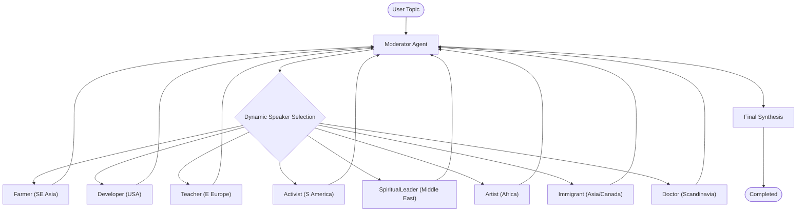

# Microsoft Agent Framework dynamic moderated 8-persona debate

## 1. Overview
This pattern implements a hub-and-spoke debate across 8 cultural perspectives using Microsoft Agent Framework `GroupChatBuilder`.

A centralized `Moderator` agent guides the discussion by selecting the next speaker based on prior arguments and produces a concluding synthesis at the end of the debate.

---

## 2. Architecture and topology

---

## 3. Package structure

- **`personas.py`**: Defines the 8 cultural perspectives and the `create_moderator_agent` factory using Microsoft Agent Framework `Agent` instances.
- **`orchestration.py`**: Compiles `GroupChatBuilder` with dynamic `orchestrator_agent`.
- **`runner.py`**: Streaming adapter inheriting from `BaseAgentRunner`. Consumes `workflow.run(prompt, stream=True)` events and emits SSE stream updates.
