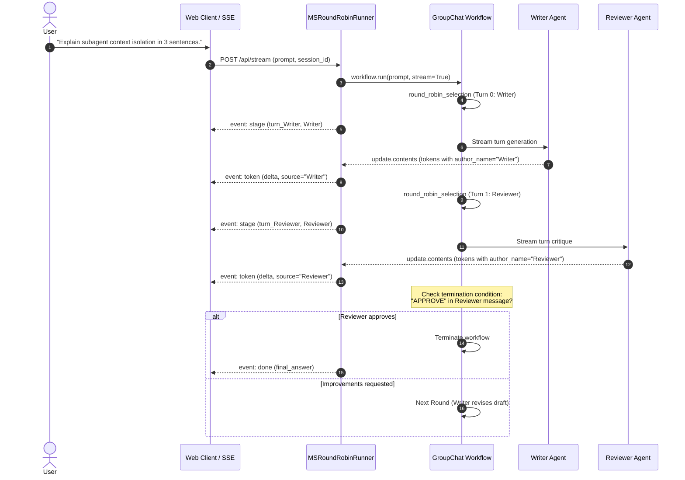

# Microsoft Agent Framework round-robin GroupChat pattern

This package implements a cyclic GroupChat between a Writer and a Reviewer using Microsoft Agent Framework (`agent-framework-orchestrations`). Turns alternate deterministically until the Reviewer emits `APPROVE` or reaches the round threshold.

---

## 1. Architectural philosophy: deterministic round-robin versus LLM moderation

In collaborative group chats, coordinating speaker turns can be managed either deterministically or through an autonomous LLM moderator:

| Architectural property | LLM-moderated discourse | Deterministic round-robin (`GroupChatBuilder`) |
| :--- | :--- | :--- |
| **Speaker selection** | Dynamic LLM evaluator decides next speaker | Pure Python modulo arithmetic (`round % count`) |
| **Orchestration latency** | Additional LLM inference step per turn | Zero latency (< 0.1 ms state transition) |
| **Token overhead** | Full transcript analyzed by moderator each turn | Zero additional tokens spent on speaker routing |
| **Local LLM reliability** | Prone to speaker loops or skipped participants | 100% guaranteed cyclic turn distribution |
| **Termination logic** | Moderator generates final summary | Python predicate (such as `APPROVE` keyword detected) |

In the Writer-Reviewer pattern, the Writer drafts technical explanations while the Reviewer critiques quality and suggests improvements. The cycle terminates as soon as the Reviewer ends their response with `APPROVE` or the safety threshold (`max_rounds=6`) is reached.

---

## 2. Sequence diagram



---

## 3. Module breakdown

The package separates agent definitions, orchestration logic, and SSE streaming:

- **[`participants.py`](./participants.py):**
  Defines the discourse agents:
  - `create_writer_agent(client, default_options)`: Configures the Writer agent instructed to produce concise technical explanations under four sentences.
  - `create_reviewer_agent(client, default_options)`: Configures the Reviewer agent instructed to critique the draft, suggest one or two improvements, or conclude with `APPROVE` if standards are met.

- **[`orchestration.py`](./orchestration.py):**
  Houses orchestration wiring and termination predicates:
  - `round_robin_selection(state: GroupChatState) -> str`: Selects the active participant cyclically using `participant_names[state.current_round % len(participant_names)]`.
  - `build_writer_reviewer_chat(participants, max_rounds=6)`: Builds the `GroupChat` workflow using `GroupChatBuilder` with `intermediate_output_from="all"` and a termination predicate checking for `"APPROVE"` in messages from `Reviewer`.

- **[`runner.py`](./runner.py):**
  The SSE streaming adapter (`MSRoundRobinRunner`). Consumes `workflow.run(prompt, stream=True)`, manages stage transitions, attributes streaming tokens to distinct speakers, filters chunk duplication, and dispatches real-time SSE events.

---

## 4. Engineering and runtime guardrails

### 4.1 ChatML multi-agent turn serialization
Local language models using ChatML templates (such as `qwen3.5:latest`) abort immediately with empty strings (`text=""`, EOS token) if prompt history ends with `role="assistant"`. In Microsoft Agent Framework group chats, prior participant turns save as `assistant`. 
All agents connect through `OllamaCompatibleOpenAIChatClient` (`src/core/patterns/common/ms_client.py`), which serializes preceding assistant turns as incoming user turns:
```text
role="user", content="[Writer]: Subagent context isolation ensures..."
```

### 4.2 GroupChat speaker extraction
In Microsoft Agent Framework, `workflow.run()` emits `WorkflowEvent` instances where `event.author_name` is `None`. The runner extracts the active speaker directly from `event.data.author_name` (on `intermediate` stream chunks) or `event.data.participant_name` (on `group_chat` transition events).

### 4.3 Streaming text deduplication
Microsoft Agent Framework emits incremental token chunks (`merge_mode="append"`) during generation, followed by a final completion update (`merge_mode="replace"`, `ResponseTextDoneEvent`) containing full message text. The runner checks:
```python
if c_type == "text" and merge_mode != "replace":
    yield AgentStreamEvent(event_type="token", payload=TokenPayload(delta=text_delta, source=author))
```
This ensures each token streams once without duplicate text in the client interface.

### 4.4 Deterministic modulo selection versus LLM routing
Using Python modulo logic avoids the failure mode of LLM moderators looping on the same speaker or skipping participants when operating on local models with strict context budgets.
