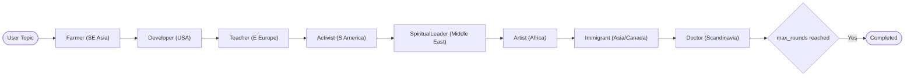

# Microsoft Agent Framework round-robin 8-persona debate

## 1. Overview
This pattern implements a cyclic discussion across 8 cultural perspectives using Microsoft Agent Framework (`agent-framework-orchestrations`). It runs locally against Ollama via `OllamaCompatibleOpenAIChatClient`.

A modulo selection function determines speaker progression without requiring a coordinator LLM, keeping latency low and execution predictable.

---

## 2. Architecture and topology

---

## 3. Package structure

- **`personas.py`**: Defines the 8 cultural perspectives using Microsoft Agent Framework `Agent` instances.
- **`orchestration.py`**: Compiles `GroupChatBuilder` with `round_robin_selection`.
- **`runner.py`**: Streaming adapter inheriting from `BaseAgentRunner`. Consumes `workflow.run(prompt, stream=True)` events and emits SSE stream updates.
