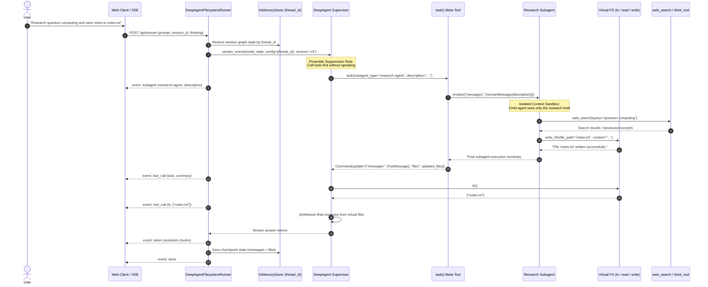

# Autonomous DeepAgent with virtual filesystem pattern

This package implements the DeepAgent pattern in LangGraph. An in-memory virtual filesystem is embedded into graph state, with multi-turn persistence provided by an `InMemorySaver` checkpointer.

---

## 1. Architectural philosophy: in-state virtual filesystem and context isolation

Multi-step research and analysis tasks require agents to inspect, manipulate, and persist structured data (notes, code, summaries) across steps without overloading the conversation message list:

| Architectural property | Traditional ReAct agent | Autonomous DeepAgent (virtual filesystem) |
| :--- | :--- | :--- |
| **State storage** | Conversational message history only | Hybrid: `messages` plus persistent in-memory `files` dictionary |
| **Large artifact handling** | Injected directly into prompt (context bloat) | Written to virtual files (`write_file`); referenced on demand (`read_file`) |
| **Multi-agent coordination** | Flat peer chatter or shared message bus | Strict caller-callee hierarchy via context-isolated `task` meta-tool |
| **Subagent scope** | Sees full conversation history | Sandboxed: receives only the targeted research brief |
| **Multi-turn memory** | Lost upon turn completion | Preserved across turns via `InMemorySaver` (`thread_id`) and `file_reducer` |
| **Tool execution safety** | Arbitrary disk I/O | In-memory virtual state with zero host filesystem writes |

In the DeepAgent pattern, the virtual filesystem (`files: dict[str, str]`) lives directly inside the LangGraph state. Both the supervisor and its child subagents (`research-agent`) can list directories (`ls`), inspect contents (`read_file`), and write artifacts (`write_file`) entirely in memory.

---

## 2. Sequence diagram



---

## 3. Module breakdown

The package separates state schemas, virtual file tools, subagents, and streaming adapters:

- **[`state.py`](./state.py):**
  Defines `DeepAgentState`, extending LangGraph's message history with a persistent virtual filesystem:
  ```python
  class DeepAgentState(TypedDict):
      messages: Annotated[list[BaseMessage], add_messages]
      files: Annotated[dict[str, str], file_reducer]
  ```
  The custom `file_reducer(current, update)` merges file updates across steps and turns, ensuring that newly written files are preserved rather than overwritten by empty updates.

- **[`file_tools.py`](./file_tools.py):**
  In-memory filesystem operations operating directly on `DeepAgentState`:
  - `ls(state)`: Lists all filenames currently stored in the virtual filesystem.
  - `read_file(file_path, state)`: Retrieves the string content of a stored virtual file.
  - `write_file(file_path, content, state)`: Writes or updates a virtual file, returning a `Command(update={"files": {file_path: content}})` to commit the change to the graph state.

- **[`research_tools.py`](./research_tools.py):**
  Domain research tools for the subagent:
  - `web_search(query)`: Executes web searches via Tavily if `TAVILY_API_KEY` is present in the environment; otherwise falls back to deterministic local domain mocks for offline testing.
  - `think_tool(thought)`: Strategic scratchpad enabling the agent to record internal deductions.

- **[`subagent.py`](./subagent.py):**
  Factory (`create_research_subagent`) creating the specialized `research-agent`. Configured with its own system prompt and tools (`web_search`, `think_tool`, `write_file`, `read_file`, `ls`) to conduct research and store findings in virtual files.

- **[`task_tool.py`](./task_tool.py):**
  The delegation factory (`create_research_task_tool`). Wraps subagent execution in a LangChain `@tool`:
  1. Validates the requested subagent type (`research-agent`).
  2. Constructs an isolated single-message prompt payload.
  3. Executes `sub_agent.invoke()`.
  4. Collects any updated files produced by the subagent and returns `Command(update={"messages": [ToolMessage(...)], "files": updated_files})`.

- **[`supervisor.py`](./supervisor.py):**
  Constructs the coordinating supervisor graph (`create_deep_agent_supervisor`) with `state_schema=DeepAgentState` and an optional checkpointer. The supervisor coordinates research tasks, inspects the virtual filesystem, and synthesizes final answers.

- **[`runner.py`](./runner.py):**
  The execution adapter inheriting from `BaseAgentRunner`. Integrates `InMemorySaver` checkpointer memory keyed by `thread_id`, synchronizes virtual files with the backend `SessionStore`, and consumes LangGraph v3 streaming events.

---

## 4. Engineering and runtime guardrails

### 4.1 In-memory filesystem reducer (file_reducer)
Standard dictionary state updates in LangGraph overwrite existing state unless an explicit reducer is provided. The `file_reducer` guarantees non-destructive updates:
```python
def file_reducer(
    current_files: dict[str, str] | None,
    update_files: dict[str, str] | None,
) -> dict[str, str]:
    merged = dict(current_files or {})
    if update_files:
        merged.update(update_files)
    return merged
```
Files created in Turn 1 (such as `research_notes.txt`) remain accessible in subsequent turns.

### 4.2 Multi-turn checkpointer memory with InMemorySaver
The runner maintains a persistent `InMemorySaver` checkpointer instance:
```python
config = {"configurable": {"thread_id": session_id}}
stream = agent.stream_events(initial_state, config=config, version="v3")
```
When subsequent user queries arrive with the same `session_id`, LangGraph restores both conversational messages and virtual filesystem state.

### 4.3 Deterministic tool fallback
External network dependencies must not break test suites or offline deployments. `web_search` dynamically checks for `TAVILY_API_KEY`:
- If configured: Queries the Tavily Search API.
- If missing: Employs a deterministic local mock returning domain-accurate search snippets.

### 4.4 Preamble suppression
To maintain strict chronological order in streaming web UIs, supervisor system prompts prohibit conversational preambles:
```text
Do not emit conversational preamble, status updates, or intermediate remarks before or between tool calls. Call tools first without speaking.
```
This ensures tool call badges and subagent indicators render above the assistant's final synthesized response.
